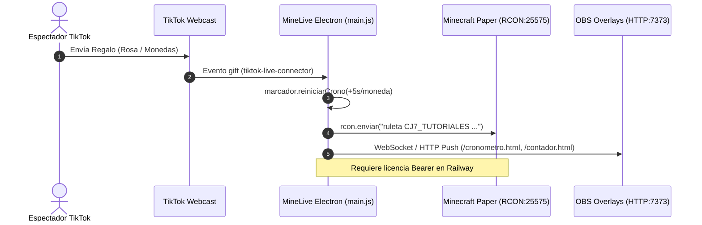
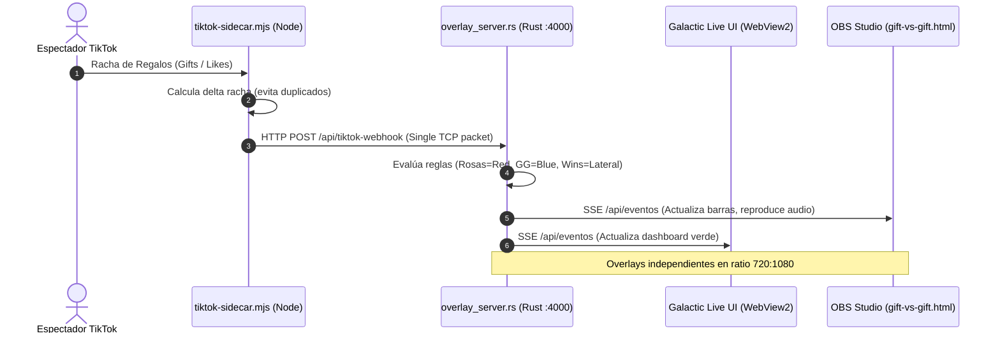

# RADIOGRAFÍA FORENSE DEL PROYECTO: ESTADO ACTUAL Y MAPEO ARQUITECTÓNICO

> **Auditoría Forense de Software (Modo Solo Lectura - READ-ONLY)**  
> **Fecha de Emisión:** 14 de Octubre de 2026  
> **Directorio de Raíz Auditado:** `c:\Users\GZ7\AppData\Local\Programs\minelive`  
> **Entorno de Coexistencia Relacionado:** `C:\Users\GZ7\AppData\Local\Programs\GZ7Live`, `galactiklive`, `C:\Users\GZ7\Documents\BuenosMalos_Backup`, `%APPDATA%\MiniLive` y `%APPDATA%\Stream To Earn`  
> **Clasificación de Seguridad:** Confidencial / OPSEC Hardened (`[REDACTED]`)

---

## 1. Contexto, Idea Original e Historial Rescatado

### 1.1 Origen: La App Base Original que se Intentó Replicar (**App A**)
El origen de este espacio de trabajo nace de la necesidad de replicar e independizar dos aplicaciones comerciales de streaming interactivo:

1. **MineLive (Electron / Node.js - v0.2.57):**
   - **Concepto:** Una aplicación de escritorio empaquetada con **Electron 44.4.1** que captura eventos en vivo de TikTok Live (regalos, comentarios, likes, follows) mediante `tiktok-live-connector` (v2.5.0) y los traduce en tiempo real a comandos de Minecraft ejecutados vía protocolo **RCON (puerto 25575)** en un servidor Paper 1.20.1 (`C:\Users\GZ7\Desktop\MINESERVER`).
   - **Funcionalidades Núcleo:**
     - Cronómetro extensible que añade segundos dinámicamente (`+5s/moneda donada`).
     - Contador de Victorias y Derrotas automatizado (suma +1 Win al expirar el tiempo en `00:00`; suma +1 Derrota al detectar la muerte del streamer en los logs de Paper).
     - Overlays locales HTTP servidos en el **puerto 7373**: `/cronometro.html`, `/contador.html`, `/mejor-regalo.html` (Top Donor con avatar) y `/overlay.html` (meta financiera en Soles `PEN` para Yape con factor de conversión `0.01875` PEN/moneda).
     - Catálogo de 26 reglas preconfiguradas (`plantilla-minelive.json`) que mapean regalos específicos a comandos (`/execute at {player} run summon creeper ~ ~ ~`, etc.).
   - **El Problema Original de Dependencia:** La app dependía de una infraestructura externa en Railway (`https://minelive-nube-production.up.railway.app`) con autenticación atada a un token Bearer (`mle_...`) cifrado mediante Windows DPAPI (`sesion-app.bin`) e identificación de máquina (`equipo-app.txt`). Para modificar su lógica, se recurrió a **parches binarios directos en `resources/app.asar`** (manipulando offsets hexadecimales en `src/core/marcador.js`, `electron/overlay.js` y `electron/main.js`).

2. **Stream To Earn (S2E):**
   - **Concepto:** Plataforma comercial de monetización en vivo con banco multimedia y tiras de eventos horizontales (multiplicadores `1x`, `10x`, `32x`, `500x`).
   - **Extracción Rescatada:** Se realizó una extracción forense desde la base de datos Snappy LevelDB de Chromium (`%APPDATA%\Stream To Earn\Local Storage\leveldb\000487.ldb`) para volcar 424 archivos multimedia sin pérdidas (258 sonidos `.mp3`, 45 iconos de TikTok, 60 iconos de Minecraft, 33 videos croma) y desbloquear los preajustes de 24 y 26 eventos (`Survival gz7` y `Survival`) superando el límite comercial de 10 eventos de la versión gratuita.

### 1.2 La Nueva Idea / Juego que se Intentó Integrar (**App B**)
Al toparse con los límites y fragilidad de los parches binarios sobre Electron, el desarrollo mutó hacia una nueva plataforma denominada **Galactic Live / GZ7Live**:

1. **Reemplazo Arquitectónico por Rust + Tauri v2:**
   - Migración del backend de Node.js a **Rust (Tauri v2 + Tokio)** para eliminar el consumo de RAM de Electron, alcanzar arranque instantáneo y blindar el binario mediante compilación nativa x86_64 (`strip = true`, `lto = true`, `opt-level = "s"`).
   - Servidor HTTP/SSE embebido en Tokio en el **puerto 4000** (`overlay_server.rs`).

2. **Nueva Modalidad de Juego: Roblox Obby (Bicicleta) & Duelos "Buenos vs Malos":**
   - Se apartó el enfoque exclusivo de Minecraft para soportar **Roblox (Obby de Bicicleta)**.
   - Creación del modo **Tug-of-War / Duelo Central (Rosas vs GG)** y columnas laterales:
     - **Columna Villanos (Izquierda / Rojo):** Donaciones de Rosas y regalos de sabotaje restan Wins o empujan al streamer al vacío.
     - **Columna Héroes (Derecha / Azul):** Donaciones de GG y bendiciones suman Wins o aceleran el progreso.
   - Lienzo matemático de overlay vertical optimizado para TikTok LIVE Studio / OBS en formato **720:1080** con sliders reactivos en tiempo real (`gift-vs-gift.html`).

3. **Evolución del Servidor de Minecraft: Buenos vs Malos (Spigot/Paper):**
   - Creación del plugin Java `BuenosMalosPlugin` (respaldado en `BuenosMalos_Backup`) con Display Entities y cinemáticas de jefes de escala masiva (La Parka, Sol Cruel, Deidad Solar, Arcángel Serafín, Dragón del Caos) interactuando con mecánicas de tótems en tiempo real.

4. **Sistema Propio de Licencias y Monitoreo ($0 Cost Cloud):**
   - Desacople total de Railway mediante un esquema de licencias criptográficas HMAC-SHA256 vinculadas al HWID (`MachineGuid` de Windows) soportado en **Supabase Free Tier** (`supabase_schema.sql`).

---

## 2. Mapa del Frankenstein (Árbol de Archivos Relevantes)

A continuación se muestra el árbol de archivos relevantes depurado de residuos (`node_modules`, archivos `.pak` masivos de Chromium y ejecutables de distribución), clasificando cada componente en:
- **[App A - Intento de réplica]**: Código legacy de MineLive / Stream To Earn.
- **[App B - Nuevo proyecto/Juego]**: Código de Galactic Live / GZ7Live (Rust/Tauri, Roblox Obby, Buenos vs Malos).
- **[Código Huérfano/Duplicado]**: Archivos desincronizados, redundantes o en desuso.

```
c:\Users\GZ7\AppData\Local\Programs\minelive\
├── CONTEXTO_CHATS.md                          [Documentación Maestra / Historial Forense]
├── MineLive.exe                               [App A - Binario Host Electron 44.4.1]
├── resources/
│   ├── app.asar                               [App A - Contenedor empaquetado con código MineLive v0.2.57]
│   └── default_app.asar                       [App A - Electron default]
│
├── (Ecosistema Extraído y Reflejado en C:\Users\GZ7\AppData\Local\Programs\GZ7Live\)
│   │
│   ├── minelive_dump/                         [App A - Intento de réplica] (Dump descompreso del app.asar)
│   │   ├── package.json                       [App A - Dependencias Node de MineLive]
│   │   ├── electron/
│   │   │   ├── inicio.js                      [App A - Entry point de Electron]
│   │   │   ├── main.js                        [App A - Orquestador IPC, RCON y Marcador]
│   │   │   ├── overlay.js                     [App A - Servidor HTTP puerto 7373]
│   │   │   ├── candado-electron.js            [App A - Validación de licencia Railway]
│   │   │   └── preload.cjs                    [App A - Preload de seguridad]
│   │   ├── src/
│   │   │   ├── core/                          [App A - Lógica de marcador, regalos y reglas]
│   │   │   ├── minecraft/                     [App A - Driver RCON, cola de comandos y mobs]
│   │   │   └── tiktok/                        [App A - Ingesta Webcast en Node.js]
│   │   └── ui/                                [App A - Interfaz vanilla Electron de MineLive]
│   │
│   ├── src-tauri/                             [App B - Nuevo proyecto/Juego] (Backend Nativo en Rust)
│   │   ├── Cargo.toml                         [App B - Manifiesto Rust Tokio/Tauri v2]
│   │   ├── src/
│   │   │   ├── main.rs                        [App B - Comandos Tauri, spawners de procesos]
│   │   │   ├── overlay_server.rs              [App B - Servidor Tokio HTTP/SSE puerto 4000]
│   │   │   ├── license_guard.rs               [App B - Guardián criptográfico HWID / HMAC]
│   │   │   ├── asset_sync.rs                  [App B - Sincronizador de assets y descargas]
│   │   │   └── rcon.rs                        [App B - Cliente RCON asíncrono Tokio]
│   │   └── templates/                         [App B - Plantillas de Overlays OBS]
│   │       ├── gift-vs-gift.html              [App B - Duelo Roblox Rosas vs GG 720:1080]
│   │       ├── mc_overlay.html                [App B - Overlay Minecraft estilo S2E]
│   │       ├── alerta.html                    [App B - Reproductor de video con Canvas Chroma Key]
│   │       ├── cronometro.html                [Código Huérfano/Duplicado] (Copia del overlay 7373)
│   │       ├── contador.html                  [Código Huérfano/Duplicado] (Copia del contador 7373)
│   │       └── top_rotativo.html              [App B - Widget de donadores rotativo]
│   │
│   ├── src/                                   [Código Huérfano/Duplicado] (Directorio desincronizado de ui/)
│   │   ├── gifts.js                           [Código Huérfano/Duplicado] (Espejo desactualizado)
│   │   ├── main.js                            [Código Huérfano/Duplicado] (Espejo desactualizado)
│   │   ├── tiktok.js                          [Código Huérfano/Duplicado] (Cliente SSE desactualizado)
│   │   ├── s2e-studio.js                      [Código Huérfano/Duplicado] (Editor S2E desactualizado)
│   │   ├── s2e-catalog.js                     [App A - Catálogo de 258 audios y videos S2E]
│   │   ├── license-client.js                  [App B - Cliente de seguridad anti-depuración]
│   │   └── sounds.js                          [App B - Sintetizador Web Audio API]
│   │
│   ├── ui/                                    [App B - Frontend Activo de Tauri (frontendDist)]
│   │   ├── index.html                         [App B - Dashboard principal Galactic Live]
│   │   ├── style.css                          [App B - Estilos visuales dark / neón]
│   │   ├── alerta.html                        [Código Huérfano/Duplicado] (Copia de templates/alerta.html)
│   │   ├── gift-vs-gift.html                  [Código Huérfano/Duplicado] (Copia de templates/gift-vs-gift.html)
│   │   └── src/
│   │       ├── gifts.js                       [App B - Buscador bilingüe y normalizador de regalos]
│   │       ├── main.js                        [App B - Despachador de eventos Roblox/MC/Alertas]
│   │       ├── tiktok.js                      [App B - Receptor EventSource SSE del puerto 4000]
│   │       ├── s2e-studio.js                  [App A - Réplica UI S2E + Algoritmo Croma Auto]
│   │       └── sounds.js                      [App B - Motor de reproducción y asignación de audio]
│   │
│   ├── s2e_media/                             [App A - Banco Multimedia Replicado de Stream To Earn]
│   │   ├── audio/public/                      [App A - 258 sonidos .mp3 limpios para directos]
│   │   ├── videos/                            [App A - 33 videos MP4/WebM con fondo verde]
│   │   └── icons/                             [App A - Iconos oficiales de regalos de TikTok]
│   │
│   ├── tiktok-sidecar.mjs                     [App B - Puente Node.js Webcast → HTTP POST Tokio]
│   ├── supabase_schema.sql                    [App B - DDL de PostgreSQL / Supabase para licencias]
│   └── CONSTRUIR_INSTALADOR.bat               [Código Huérfano/Duplicado] (Script NSIS legacy)
│
├── (Módulos Aislados en C:\Users\GZ7\Documents\BuenosMalos_Backup\)
│   ├── BuenosMalosPanel/                      [App B - Servidor Express + WebSocket para control]
│   │   ├── server.js                          [App B - Servidor HTTP 3000 + WS con GIFT_TABLE]
│   │   └── public/                            [App B - UI de control de tótems]
│   └── BuenosMalosPlugin/                     [App B - Plugin Spigot/Paper 1.20.1 Buenos vs Malos]
│       ├── pom.xml                            [App B - Configuración Maven del plugin Java]
│       └── src/main/java/com/gz7/ruletabm/    [App B - 14 clases Java de jefes y animaciones]
│
└── (Intento Fallido en C:\Users\GZ7\AppData\Local\Programs\galactiklive\)
    ├── package.json                           [Código Huérfano/Duplicado] (Esqueleto Electron v2)
    ├── main.js                                [Código Huérfano/Duplicado] (Ventana Electron minimalista)
    ├── preload.js                             [Código Huérfano/Duplicado] (Bridge básico)
    └── AGENT_CONTEXT.md                       [Documentación de intento de bifurcación]
```

---

## 3. Stack Tecnológico y Dependencias

A lo largo del ecosistema se detectaron 4 manifiestos principales en distintas subcarpetas:

### 3.1 Manifiesto 1: `minelive/resources/app.asar/package.json` (MineLive Original - App A)
- **Runtime:** Node.js `>=22.15` / Electron 44.4.1 (ES Modules `"type": "module"`).
- **Dependencias Clave:**
  - `tiktok-live-connector`: `2.5.0` (Conector Webcast Protobuf no oficial para TikTok).
  - `ws`: `^8.21.3` (WebSockets).
  - `pg`: `^8.23.0` (Cliente PostgreSQL para telemetría).
  - `https-proxy-agent`: `^5.0.1` (Túnel para evitar bloqueos por rate limit de IP).

### 3.2 Manifiesto 2: `GZ7Live/src-tauri/Cargo.toml` (Galactic Live Backend - App B)
- **Lenguaje / Compilador:** Rust 2021 Edition.
- **Framework de Escritorio:** Tauri `v2` (`tauri = "2"`, `tauri-build = "2"`).
- **Asincronía y Servidor:** `tokio = { version = "1", features = ["full"] }`.
- **Serialización:** `serde = { version = "1", features = ["derive"] }`, `serde_json = "1.0"`.
- **Plugins Tauri:** `tauri-plugin-updater = "2"`, `tauri-plugin-process = "2"`.
- **Perfil de Optimización (`[profile.release]`):** `panic = "abort"`, `lto = "thin"`, `opt-level = 2`, `strip = true`.

### 3.3 Manifiesto 3: `GZ7Live/package.json` (Galactic Live Frontend & Sidecar)
- **Entorno:** Node.js (ES Modules).
- **Dependencias:**
  - `tiktok-live-connector`: `^2.5.0` (Utilizado exclusivamente por `tiktok-sidecar.mjs`).
  - `@tauri-apps/cli`: `^2.0.0` (Herramienta CLI para compilación del binario).

### 3.4 Manifiesto 4: `BuenosMalos_Backup/BuenosMalosPanel/package.json`
- **Runtime:** Node.js (CommonJS).
- **Dependencias:** `express`, `ws`, `cors`.

### 3.5 Manifiesto 5: `BuenosMalos_Backup/BuenosMalosPlugin/pom.xml`
- **Lenguaje:** Java 17.
- **API Base:** PaperMC / Spigot API `1.20.1-R0.1-SNAPSHOT`.
- **Librerías:** SAPI / PowerShell Bridge para TTS, Display Entities nativas.

### 3.6 Librerías Frontend y Gráficas Identificadas en Código
- **HTML5 Canvas 2D:** Utilizado en `ui/src/s2e-studio.js` para el motor de Croma Key Euclidiano (*despill* y tolerancia en tiempo real).
- **Web Audio API:** Síntesis nativa procedural de osciladores en `ui/src/sounds.js` (sonidos meme: Vine Boom, MLG Airhorn, Metal Pipe, etc.).
- **SSE (Server-Sent Events):** `EventSource` nativo del navegador consumiendo el endpoint `http://127.0.0.1:4000/api/eventos`.

---

## 4. Auditoría de Estado: ¿Qué Funciona y Qué Está Roto?

### ✅ Lo que SÍ Funciona / Está Bien Estructurado (Piezas de Alto Valor)

1. **El Motor Sidecar de TikTok (`tiktok-sidecar.mjs`):**
   - Resuelve el problema de WebView2 encapsulando la captura en un proceso `node.exe` independiente.
   - Cuenta con una tabla de seguimiento de combos incremental (`activeStreaks` / `closedStreaks`) que evita disparos duplicados o pérdidas en rachas de Rosas o GGs.
   - Implementa un socket TCP único y coalescido (`singleInstanceServer` en puerto `21219`) que mata instancias huérfanas al cambiar de sala y envía paquetes HTTP sin fragmentar a Tokio.

2. **El Servidor HTTP/SSE Tokio en Rust (`overlay_server.rs`):**
   - Altamente eficiente: sirve overlays estáticos (`gift-vs-gift.html`, `mc_overlay.html`, `alerta.html`) sin latencia y despacha eventos a cientos de clientes vía SSE (`broadcast::channel`).
   - Sincroniza dinámicamente las imágenes de regalos desde caché local (`/gifts/`) y reproduce audio directamente en OBS (`/s2e_media/audio/public/`).

3. **Overlay Duelo Roblox 720:1080 (`gift-vs-gift.html`):**
   - Estructura CSS sólida con ratio fijo vertical bloqueado y escalado inteligente por viewport.
   - 5 temas visuales conmutables por CSS GPU (`GALACTIC`, `SOL`, `CONTRASTE`, `MOVIMIENTO`, `NEON`).
   - Columnas independientes para Villanos y Héroes con barras de ventaja dinámicas.

4. **Motor de Croma Key y Alertas S2E (`ui/src/s2e-studio.js` & `alerta.html`):**
   - Detección perimetral automática del color de fondo (`🪄 Croma Auto`) muestreando las 4 esquinas del video en Canvas 2D, con algoritmo de distancia euclidiana y supresión de halo verde.
   - Integración con 33 animaciones y videos locales.

5. **Banco Multimedia Offline (424 Assets en `s2e_media`):**
   - 258 audios `.mp3` perfectamente catalogados con formas de onda SVG precalculadas (`peaks`).

6. **Lógica de Jefes en Java (`BuenosMalosPlugin`):**
   - Animaciones cinematográficas complejas escritas para Paper 1.20.1 con temporizadores asíncronos y mecánicas de drenado de tótems (Sol Cruel, La Parka, Fénix, etc.).

---

### ❌ Lo que NO Funciona / Está a Medias / Roto

1. **Desincronización Espejo entre `src/` y `ui/`:**
   - En `GZ7Live`, existen archivos duplicados: `src/gifts.js` vs `ui/src/gifts.js`, `src/main.js` vs `ui/src/main.js`, `src/tiktok.js` vs `ui/src/tiktok.js`.
   - **Causa del Fallo:** Tauri v2 está configurado para empaquetar desde `"frontendDist": "../ui"`. Cualquier cambio que se realice en la carpeta `src/` de la raíz es ignorado por la aplicación compilada, generando confusión sobre por qué ciertas funciones no tenían efecto.

2. **Parcheado Binario Frágil en `minelive/resources/app.asar`:**
   - En la app original de MineLive, cualquier modificación dependía de sobreescribir bytes exactos en `marcador.js` (11,050 bytes), `overlay.js` (15,502 bytes) y `main.js` (84,724 bytes). Si el tamaño del archivo varía en 1 solo byte, los punteros del header del archivo ASAR colapsan y `MineLive.exe` no inicia (`A JavaScript error occurred in the main process`).

3. **El Falso Conector de TikTok en Frontend (`ui/src/tiktok.js` vs WebSocket TikFinity):**
   - En versiones anteriores de `tiktok.js`, la interfaz intentaba conectar a `ws://127.0.0.1:21213/?username=...` (puerto de TikFinity).
   - Como TikFinity no estaba abierto, el socket disparaba un error y 1 ms después el evento `onclose`, el cual ejecutaba incondicionalmente `handleDisconnected()`, desconectando visualmente la aplicación de inmediato y provocando bucles infinitos de reconexión.
   - En la UI figuraban 4 botones de pestañas que no implementaban lógica de red real.

4. **Conflicto de Puertos Locales:**
   - Si se intentan ejecutar las herramientas en simultáneo, colisionan los puertos:
     - `7373` (Servidor HTTP de MineLive).
     - `4000` (Servidor Tokio de Galactic Live).
     - `3000` (Servidor Express de BuenosMalosPanel).
     - `3855` (Servidor HTTP de MiniLiveRuletaPlugin).
     - `25575` (Puerto RCON de Minecraft).

5. **Archivos Basura y Logs Residuales en Disco:**
   - Archivos `err.log`, `out.log`, `test_err.log`, `test_out.log`, `CONSTRUIR_INSTALADOR.bat`, `.bak` sueltos acumulados en la raíz de `GZ7Live`.

---

### 🔌 Estado de la Conexión con TikTok / RCON / WebSockets

```
┌──────────────────────────────────────────────────────────────────────────────────┐
│              ANOMALÍA Y ESTADO DE LA CONEXIÓN TIKTOK LIVE                        │
└──────────────────────────────────────────────────────────────────────────────────┘

   [Streamer en TikTok Live Studio / App Móvil]
                         │
                         ▼ (Webcast Protobuf no documentado)
               [tiktok-live-connector v2.5.0]
                         │
                         ├─────────────────────────────────────────┐
                         ▼ (EN MINELIVE - Node.js)                 ▼ (EN TAURI - WebView2)
              [src/tiktok/conexion.js]                  [ui/src/tiktok.js]
              - Funciona en Electron                    - FALLA: WebView2 NO es Node.js
              - Acoplado a app.asar                     - Intentaba import() fallido
                                                        - Caía en ws://127.0.0.1:21213 (TikFinity)
                                                        - onclose cerraba la app en 1ms
                                                                   │
                                                                   ▼ (SOLUCIÓN HÍBRIDA)
                                                        [tiktok-sidecar.mjs]
                                                        - Subproceso: node.exe
                                                        - Escucha Webcast nativo
                                                        - Normaliza combos y rachas
                                                        - Envía POST HTTP /api/tiktok-webhook
                                                                   │
                                                                   ▼ (Puerto 4000)
                                                        [overlay_server.rs (Tokio)]
                                                        - Falla resuelta: fragmentación TCP
                                                        - Emite SSE vía /api/eventos
                                                                   │
                                                                   ▼
                                                        [OBS Studio: Browser Source]
```

#### ¿Por qué fallaba y cómo se resolvió?
1. **El choque WebView2 vs Node.js:** En Tauri, la UI corre sobre el motor Chromium de Windows (WebView2), el cual no tiene acceso al runtime de Node.js ni a sockets de bajo nivel. Intentar cargar `tiktok-live-connector` desde el frontend provocaba excepciones inmediatas.
2. **La Fragmentación TCP de Node 24:** En Node.js v24+, `fetch()` fragmenta las peticiones HTTP dividiendo los encabezados y el body JSON en paquetes separados. `overlay_server.rs` en Rust hacía una sola lectura asíncrona del socket (`stream.read`), recibiendo encabezados con cuerpo vacío y descartando el evento de TikTok. La solución requirió migrar a un socket `node:net` con buffers coalescidos (`Buffer.concat([headerBuf, bodyBuf])`).
3. **El Mapeo de IDs de Regalo:** TikTok v2.5.0 anidó los datos dentro de `data.gift` o `data.extendedGiftInfo`. Regalos como `GG` tienen múltiples IDs (`6064`, `6093`, `7214`). Si el registro local solo buscaba `7214`, el regalo de 1 moneda (`6064`) era clasificado como `'Regalo Desconocido'`, rompiendo los disparadores en pantalla.

---

## 5. Flujo de Datos Actual (Cómo se Comunican las Partes)

Actualmente existen dos pipelines paralelos y desconectados en el entorno:

### Pipeline 1: MineLive Legacy (Electron - Puerto 7373)


### Pipeline 2: Galactic Live / GZ7Live (Rust + Sidecar - Puerto 4000)


---

## 6. Inventario de Piezas Rescatables (Archivos que Valen Oro)

La siguiente lista contiene las joyas arquitectónicas, librerías y lógicas que deben extraerse y preservarse limpiamente en el nuevo proyecto desde cero:

### A. Banco Multimedia y Assets (100% Reutilizables)
1. **`C:\Users\GZ7\AppData\Local\Programs\GZ7Live\s2e_media\audio\public\*.mp3`**  
   - 258 efectos de sonido limpios de Stream To Earn (alertas, memes, celebraciones, subidas de nivel).
2. **`C:\Users\GZ7\AppData\Local\Programs\GZ7Live\s2e_media\videos\*.mp4`**  
   - 33 animaciones con fondo verde para alertas Chroma Key.
3. **`C:\Users\GZ7\AppData\Local\Programs\GZ7Live\s2e_media\icons\*.png`**  
   - 45 iconos de regalos oficiales de TikTok en alta resolución.
4. **`C:\Users\GZ7\AppData\Local\Programs\GZ7Live\s2e_media\mc_icons\*.png`**  
   - 60 iconos oficiales de mobs y acciones de Minecraft.

### B. Módulos de Ingesta y Conexión TikTok
5. **`C:\Users\GZ7\AppData\Local\Programs\GZ7Live\tiktok-sidecar.mjs`**  
   - El motor de captura más estable del proyecto: resuelve desconexiones de WebView2, previene colisiones por socket de instancia única y maneja deltas de rachas de regalos de TikTok.
6. **`C:\Users\GZ7\AppData\Local\Programs\GZ7Live\ui\src\gifts.js`**  
   - Motor de búsqueda bilingüe español-inglés (`SPANISH_SEARCH_MAP`) con función de equivalencia universal `giftsEquivalentes()` y soporte para 1,770 regalos de TikTok.
7. **`C:\Users\GZ7\AppData\Local\Programs\GZ7Live\src\gifts-data.json`**  
   - Base de datos completa serializada de los 1,770 regalos de TikTok con IDs, costos en monedas y rutas de iconos.

### C. Backend de Alto Rendimiento (Rust / Tokio)
8. **`C:\Users\GZ7\AppData\Local\Programs\GZ7Live\src-tauri\src\overlay_server.rs`**  
   - Servidor web asíncrono Tokio capaz de despachar overlays y eventos SSE a latencia cero con soporte para WebSockets y resolución de CORS para OBS.
9. **`C:\Users\GZ7\AppData\Local\Programs\GZ7Live\src-tauri\src\license_guard.rs`**  
   - Motor criptográfico que genera huellas de hardware inmutables (`HWID`) basadas en `MachineGuid` de Windows y valida claves `GLK.` mediante HMAC-SHA256 con shards ofuscados en memoria.
10. **`C:\Users\GZ7\AppData\Local\Programs\GZ7Live\supabase_schema.sql`**  
    - Esquema relacional PostgreSQL con RLS y función RPC `bind_hwid_on_login` para monetización y licenciamiento en la nube a costo $0/mes en Supabase Free Tier.

### D. Overlays y Motores Frontend (UI)
11. **`C:\Users\GZ7\AppData\Local\Programs\GZ7Live\src-tauri\templates\gift-vs-gift.html`**  
    - Lienzo vertical estricto 720:1080 para Roblox/Minecraft con duelo interactivo Tug-of-War, columnas de villanos/héroes y 5 estilos CSS GPU.
12. **`C:\Users\GZ7\AppData\Local\Programs\GZ7Live\ui\src\s2e-studio.js`**  
    - Algoritmo de Croma Key en tiempo real con detección perimetral automática (`🪄 Croma Auto`) y modal interactivo de selección de audios con filtros y visualizadores SVG.
13. **`C:\Users\GZ7\AppData\Local\Programs\GZ7Live\ui\src\sounds.js`**  
    - Motor de audio con colas de prioridad (`priority`, `once`, `overlap`), volumen independiente y fallback a sintetizador de osciladores Web Audio API.

### E. Lógica de Minecraft y Servidor Paper 1.20.1
14. **`C:\Users\GZ7\Documents\BuenosMalos_Backup\BuenosMalosPlugin\src\main\java\com\gz7\ruletabm\`**  
    - Código fuente Java con las 14 cinemáticas de jefes (Sol Cruel, La Parka, Arcángel, Fénix, Dragón) y el guardián de sesión `GalacticPassGuard.java`.
15. **`C:\Users\GZ7\AppData\Roaming\MiniLive\plantillas\plantilla-minelive.json`**  
    - Configuración maestra con 26 reglas probadas de comandos de Minecraft por regalo de TikTok.
16. **`C:\Users\GZ7\AppData\Local\Programs\GZ7Live\minelive_dump\src\minecraft\rcon.js`**  
    - Implementación pura en Node.js del protocolo binario de paquetes RCON con empaquetado `Little-Endian` y colas resilientes ante reconexiones.

---

## 7. Dictamen Forense Final

El espacio de trabajo actual refleja una transición interrumpida: **se intentó pasar de una aplicación cerrada de Electron parcheada a nivel de bytes a una plataforma híbrida de alto rendimiento en Rust/Tauri**, acumulando código huérfano, espejos desincronizados y dependencias cruzadas en el proceso.

El camino óptimo para la reestructuración fuera de este directorio es:
1. **Crear un repositorio limpio desde cero** (monorepo o backend/frontend desacoplado).
2. **Adoptar Rust (Tauri v2) + Node Sidecar** como arquitectura oficial para la ingesta de TikTok y el servidor de overlays (descartando completamente Electron y los parches binarios a `app.asar`).
3. **Mudar directamente las 16 piezas rescatables inventariadas en la Sección 6**, garantizando un proyecto modular, sin dependencias de servicios externos vulnerables y listo para producción.
